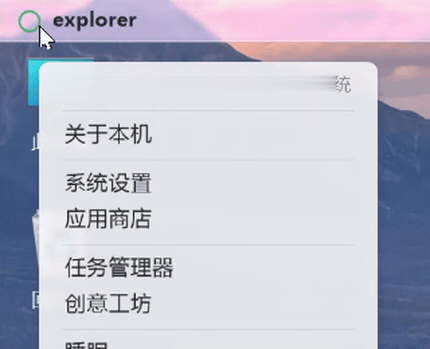
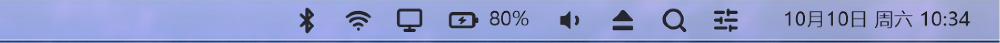
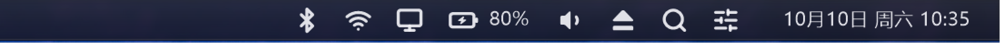

# MyDock

**Windows 上的 macOS 体验** —— 一条 Dock、一个全屏启动台、一根顶部状态栏。纯 Win32 + GDI+ 实现，无任何第三方运行时依赖，编译出来就是一个 `.exe`。

<p align="center">
  <br>
  
</p>

| 浅色 | 深色 |
|---|---|
|  |  |

## 特性

**Dock 条**
- 固定区 + 运行区（分隔线右侧自动出现正在运行、未固定的应用）
- 悬停高亮（放弃了悬停放大 —— 高亮不占宽度，布局恒定零抖动）
- 右键菜单：打开 / 固定与移除 / 左移右移排序 / 打开所在文件夹
- 磨砂玻璃底（实时截屏模糊），应用全屏时自动让位

**启动台**（F4 或点 Dock 图标）
- 全屏毛玻璃 + 实时搜索（支持拼音首字母）
- 右键固定到 Dock / 移出启动台；左上角「+」手动添加任意 exe

**顶部状态栏**（形似 macOS 菜单栏，AppBar 方式预留工作区）
- 深浅色跟随桌面上窗口的亮度平滑渐变
- 左上角圆环：系统菜单（关于 / 设置 / 睡眠 / 重启 / 关机 / 退出）
- 右上角状态图标，全部读**真实状态**：
  - Wi-Fi —— 可用网络列表，点已保存的网络直接连接
  - 蓝牙 —— 已配对设备列表，点设备通过 `BluetoothSetServiceState` 发起连接
  - 显示器（Win+P 投影）/ 电池（含剩余时间）/ 音量（静音开关）/ Spotlight（Win+S）/ 控制中心
- ⏏ 图标 = 系统菜单：显示 Dock / 开机自启 / 重启 / 退出 / 此电脑
- 时钟点开是自绘日历面板（今天红圈、周末红字、可翻月）

**控制中心**（替代 Win+A）
- Wi-Fi 真开关（软件无线电）、蓝牙、投影、静音磁贴
- 音量滑条实时生效；亮度滑条在支持 DDC/CI 的屏幕上出现
- 电池行 + 设置入口，macOS 配色

**工程底子**
- 多显示器 + Per-Monitor DPI V2（Dock 跟随鼠标所在屏，按屏 DPI 计算尺寸；处理 `WM_DPICHANGED`）
- 「哪些应用在运行」的枚举与开始菜单全量扫描都在后台线程，UI 线程零阻塞
- 配置文件原子写入（写临时文件 → `ReplaceFileW`），崩溃断电不会留下空清单
- 应用身份统一路径规范化（8.3 短名 / `\\?\` 前缀 / 大小写 / 反斜杠差异不再造成重复图标）
- 单实例互斥体、后台线程退出时逐一收尾、COM/GDI+ 生命周期严格配对

## 下载

无需自己编译：到 [Releases](https://github.com/glitch-cmyk658/MyDock/releases/latest)
下载最新版 zip（当前 `MyDock-v1.0.2.zip`），解压后把 `MyDock.exe` 放到任意目录双击运行。

> 首次运行若弹出 SmartScreen 警告（**Windows 已保护你的电脑**），点
> **更多信息 → 仍要运行**——程序未购买代码签名证书，属正常现象，仅首次。

## 主题与图标包

配色集中在语义化调色板（19 个命名色 × 深浅两套）。复制仓库根目录的
`theme.example.ini` 到 `%APPDATA%\MyDock\theme.ini`，改任意颜色（`AARRGGBB`）
**保存即生效**——Dock 的轮询会自动发现文件变化，不用重启。没写的 key 落回
内建默认，删掉 `theme.ini` 即回到原版。

图标包：把 Lucide 风格的 SVG 放进 `%APPDATA%\MyDock\icons\`，按名字覆盖
内置状态图标（如 `wifi.svg`、`battery.svg`、`volume-2.svg`、`search.svg`），
文件里每个 `d="..."` 都会被解析，没有对应文件时回落内置图标。

## 测试

纯逻辑函数（路径规范化、URI 解码、路径分段）有单元测试：

```cmd
tests.cmd        :: 跑 tests/tests.cpp（20 项断言），失败返回非零码
```

## 构建

需要 [MinGW-w64](https://www.mingw-w64.org/)（GCC 13+，本项目用 15.2）：

```bat
build.cmd
```

或者用 CMake：

```bat
cmake -B build -G "MinGW Makefiles"
cmake --build build
```

产物为单个 `MyDock.exe`（静态链接，约 1.8 MB），放到任意目录运行即可。

> 注意：`build.cmd` 里固化了完整的编译命令，其中 `-mwindows` 绝不能漏 ——
> 漏了会链成控制台子系统，启动黑窗 + DPI 被父进程污染，详细解释见文件顶部注释。

## 使用

| 操作 | 方式 |
|---|---|
| 唤出 Dock | 鼠标贴屏幕底边 |
| 启动台 | `F4` 或 Dock 上点启动台图标 |
| Spotlight | 点顶栏搜索图标（`Win+S`） |
| 控制中心 | 点顶栏「两排开关」图标 |
| 日历 | 点顶栏时钟 |
| 系统菜单 | 右键 Dock 空白处 / 左上角圆环 / 顶栏 ⏏ |

配置文件在 `%APPDATA%\MyDock\`：

| 文件 | 作用 |
|---|---|
| `pinned.txt` | Dock 上显示的应用（每行一个 .lnk / .exe 路径；`@launchpad` `@trash` `@calendar` 是内建格子） |
| `hidden.txt` | 从启动台移除的应用 |
| `added.txt` | 手动加进启动台的应用 |
| `settings.ini` | 各种开关（悬停高亮、状态栏、唤醒判定线……） |

三个清单均为 UTF-16LE，支持 `;` 注释行，程序原子写入。

## 源码结构

```
src/
  main.cpp        入口：DPI 感知、GDI+/COM 初始化、消息循环
  dock.*          Dock 条：布局、悬停高亮、运行区、托盘
  launcher.*      全屏启动台：网格布局、搜索、翻页
  topbar.*        顶部状态栏：毛玻璃、状态图标、日历/控制中心入口
  menu.*          自绘弹出菜单（Dock / 启动台 / 顶栏共用同一套外观）
  flyout.*        日历面板
  ccenter.*       控制中心
  apps.*          开始菜单扫描、图标提取、三份配置清单
  appaction.*     应用操作抽象（打开/固定/移除/所在文件夹…）
  status.*        系统状态采集（电池/音量/Wi-Fi/蓝牙/亮度）
  svgicon.*       Lucide 图标矢量数据 → GDI+ 绘制
  recents.*       VSCode 最近项目（Dock 左键快速进入）
  util.*          DPI、路径规范化、显示器信息、日志、原子工具
```

超过 150 条踩坑记录（GDI+ 的 HasAlpha 标志、`-mwindows` 与 DPI、AppBar 时序、
MinGW 头文件差异、托盘 zombie 图标……）整理在 [DEVLOG.md](DEVLOG.md)。

## 已知限制

- **亮度滑条**：需要显示器支持 DDC/CI。笔记本内屏大多不支持（探测到会自动隐藏滑条，不会崩溃）
- **连接新 Wi-Fi**：需要输密码，会打开系统设置页完成
- **蓝牙配对**：新设备仍需系统设置页配对；已配对设备可一键发起连接
- **启动台**固定在主屏（对齐 macOS 行为）

## 许可证

[MIT](LICENSE) —— 随意使用、修改、分发，唯一要求是保留版权声明。
图标矢量数据来自 [Lucide](https://lucide.dev)（ISC License）。
